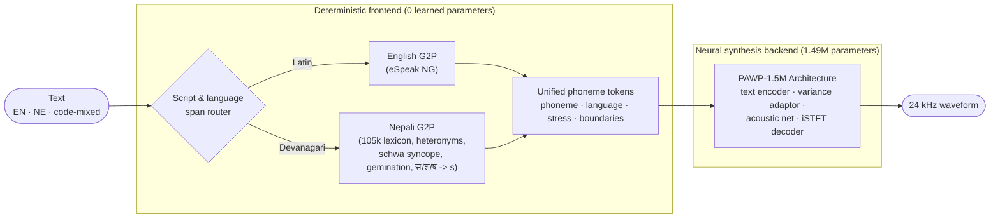
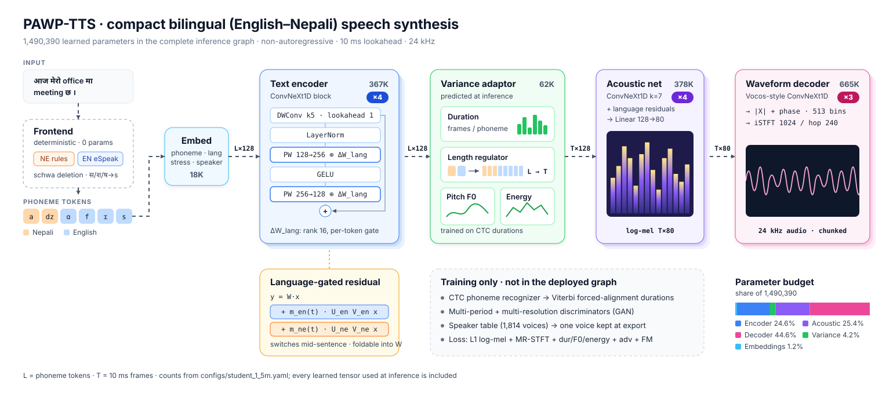

# PAWP-TTS

**Phoneme-Aware Weight Programming for Ultra-Compact Bilingual (English–Nepali) Neural Speech Synthesis**

PAWP-TTS investigates how few neural parameters are required for natural, streaming, bilingual **English**, **Nepali**, and **English–Nepali code-mixed** speech when deterministic linguistic knowledge is moved to the frontend and an AI agent (**Gemini 4 Neon**) can inspect and program trained network weights directly ([weight-space programming](https://rikiyat.github.io/blog/weight-space-programming/)).

The deployed `PAWP-1.5M` inference graph — **neural iSTFT vocoder included** — totals **1,490,390 parameters** (`5.98 MB` FP32 safetensors; `5.16 MB` folded ONNX) and outputs **24 kHz** audio with single-digit millisecond streaming time-to-first-audio (TTFA).

> **Research repository.** Every reported number is tied to a logged experiment in [docs/EXPERIMENTS.md](docs/EXPERIMENTS.md) and [docs/BENCHMARKS.md](docs/BENCHMARKS.md).

---

## Pretrained Releases (Hugging Face)

| Release | Hugging Face | Footprint | Highlights |
| :--- | :--- | :---: | :--- |
| **`PAWP-1.5M` Polished Default** (`EXP-012`) | [Firoj112/pawp-tts-1.5m](https://huggingface.co/Firoj112/pawp-tts-1.5m) | `5.98 MB` FP32 / `5.16 MB` ONNX | Smoothest single-speaker voice timbre (`4.86%` EN, `11.41%` NE, `10.99%` Code-Mix WER) |
| **`PAWP-1.5M` Weight-Space Programmed** (`EXP-009`, `WSP-E3`) | [Firoj112/pawp-tts-1.5m-wsp](https://huggingface.co/Firoj112/pawp-tts-1.5m-wsp) | `5.98 MB` FP32 / `5.16 MB` ONNX | Zero-training surgical edit by Gemini 4 Neon (`3.3%` params edited): `9.93%` NE WER, `9.93%` Code-Mix WER, `0.00%` NE drift |

---

## Audio Samples (24 kHz, Unedited Outputs)

**Instant Browser Playback (Zero Buffering):** [Listen to all samples on Hugging Face Spaces (`Firoj112/pawp-tts-demo`)](https://huggingface.co/spaces/Firoj112/pawp-tts-demo)

All samples below were synthesized directly from our default polished checkpoint ([Firoj112/pawp-tts-1.5m](https://huggingface.co/Firoj112/pawp-tts-1.5m)):

| Language / Type | Text | Direct 24 kHz WAV |
| :--- | :--- | :---: |
| Nepali (Natural) | नेपालको प्राकृतिक सौन्दर्य र अग्ला हिमाल हेर्न संसारभरिबाट मानिसहरू आउँछन्। | [`ne_nature.wav` (4.9s)](https://huggingface.co/Firoj112/pawp-tts-1.5m/resolve/main/samples/ne_nature.wav) |
| Nepali (Phonology: gemination & `/s/`) | पाता र पत्ता अनि शहर र सहरको उच्चारण मानक नेपालीमा स्पष्ट सुनिन्छ। | [`ne_phonology.wav` (4.8s)](https://huggingface.co/Firoj112/pawp-tts-1.5m/resolve/main/samples/ne_phonology.wav) |
| English (Technical) | Neural speech synthesis can now run completely on edge devices with very low latency. | [`en_edge.wav` (5.5s)](https://huggingface.co/Firoj112/pawp-tts-1.5m/resolve/main/samples/en_edge.wav) |
| English (Expressive) | The sudden change in the weather made the evening walk surprisingly refreshing. | [`en_weather.wav` (4.6s)](https://huggingface.co/Firoj112/pawp-tts-1.5m/resolve/main/samples/en_weather.wav) |
| Code-Mixed (Everyday) | Flight ticket confirm भइसक्यो, बाँकी details म तिमीलाई WhatsApp मा पठाइदिन्छु। | [`codemix_flight.wav` (5.3s)](https://huggingface.co/Firoj112/pawp-tts-1.5m/resolve/main/samples/codemix_flight.wav) |
| Code-Mixed (Technical) | आज हाम्रो team ले नयाँ AI model deploy गर्‍यो, performance एकदमै smooth देखिन्छ। | [`codemix_deploy.wav` (5.4s)](https://huggingface.co/Firoj112/pawp-tts-1.5m/resolve/main/samples/codemix_deploy.wav) |

Additional `WSP-E3` samples with native inline audio players are also hosted on [Firoj112/pawp-tts-1.5m-wsp](https://huggingface.co/Firoj112/pawp-tts-1.5m-wsp).

---

## Benchmark Results

### 1. Held-Out Live ASR Evaluation (`30` EN, `30` NE, `9` Code-Mixed)

Scored against an independent speech recognizer alongside the human studio ground-truth recording floor ([docs/BENCHMARKS.md](docs/BENCHMARKS.md)):

| Model / Checkpoint | English WER / CER | Nepali WER / CER | Code-Mixed WER / CER | NepTTS-Bench (77 pairs) |
| :--- | :---: | :---: | :---: | :---: |
| Human Studio Ground-Truth Floor | `2.63% / 0.75%` | `11.60% / 3.82%` | `25.91% / 12.88%` | — |
| `PAWP-1.5M` Base (Step 92k, [EXP-007](docs/EXPERIMENTS.md)) | `3.14% / 1.01%` | `12.02% / 3.12%` | `16.18% / 11.02%` | `100.0%` (`0%` Hindi `/ʃ/` bleed) |
| `PAWP-1.5M` Target Voice (Step 20k, [EXP-008-FT](docs/EXPERIMENTS.md)) | `5.03% / 2.28%` | `9.93% / 1.97%` | `11.99% / 4.92%` | `100.0%` (`0%` Hindi `/ʃ/` bleed) |
| **`PAWP-1.5M` Polished Default (+10k, [EXP-012](docs/EXPERIMENTS.md))** | **`4.86% / 2.79%`** | **`11.41% / 2.66%`** | **`10.99% / 4.10%`** | **`100.0%`** (`0%` Hindi `/ʃ/` bleed) |
| **`PAWP-1.5M` + WSP `E3` (Zero-Training Edit, [EXP-009](docs/EXPERIMENTS.md))** | **`5.03% / 2.20%`** | **`9.93% / 1.97%`** | **`9.93% / 3.97%`** | **`100.0%`** (`0%` Hindi `/ʃ/` bleed) |
| `PAWP-1.5M` + WSP `Null-64` (Zero-Training Edit, [EXP-009](docs/EXPERIMENTS.md)) | `4.73% / 2.02%` | `10.09% / 1.93%` | `11.65% / 4.90%` | `100.0%` (`0%` Hindi `/ʃ/` bleed) |

### 2. Streaming Latency & ONNX Parity

Folded monolingual ONNX streaming graphs (`5.16 MB` FP32 each) match PyTorch streaming waveforms to `MAE = 0.000155–0.001389` (`cosine = 0.987–0.99998`):

| Backend | Hardware | Streaming TTFA (`p50 / p95 / p99`, 60 ms chunk) | Real-Time Factor (`RTFx / RTF`) |
| :--- | :--- | :---: | :---: |
| ONNX Runtime (CPU, folded) | CPU (4 threads) | `1.11 / 1.42 / 1.52 ms` | `173.36x` (`0.0058`) |
| PyTorch (CPU, folded) | CPU (4 threads) | `3.26 / 3.86 / 4.21 ms` | `74.49x` (`0.0134`) |
| PyTorch (CUDA, folded) | NVIDIA RTX 4090 | `3.30 / 3.67 / 3.72 ms` | `96.36x` (`0.0104`) |

---

## Project Milestones

| Milestone | Scope | State |
| :--- | :--- | :--- |
| M1 | Clean Architecture bootstrap, unified 128-token EN/NE phoneme inventory, rule-based Nepali + code-mix G2P, 1.5M blueprint | done |
| M2 | Bilingual manifests and leak-free splits, eSpeak English G2P, ONNX chunked streaming path, MR-STFT + MPD/MRD losses | done |
| M3 | 105,868-word Kathmandu lexicon (`300/300` native gold pass), CTC forced-alignment durations, 92k base + 20k target-voice FT + 10k phase polish | **done** ([EXP-007](docs/EXPERIMENTS.md), [EXP-008-FT](docs/EXPERIMENTS.md), [EXP-012](docs/EXPERIMENTS.md)) |
| M4 | Agent-driven weight-space programming (`EXP-009`, Gemini 4 Neon), zero-shot compression frontier (`EXP-010`), and `PAWP-300K` (`281K` unique params, `0.28 MB` INT8) shared-basis training (`EXP-011`) | **in progress** (`EXP-011` training) |
| M5 | Trained ONNX FP32 export & parity verification, public Hugging Face model cards & audio releases | **done** ([pawp-tts-1.5m](https://huggingface.co/Firoj112/pawp-tts-1.5m), [pawp-tts-1.5m-wsp](https://huggingface.co/Firoj112/pawp-tts-1.5m-wsp)) |

---

## Architecture

### End-to-End Pipeline



### `PAWP-1.5M` Parameter Breakdown

<p align="center">
  
</p>

| Component | Parameters | Share |
| :--- | ---: | ---: |
| Embeddings and conditioning | 18,432 | 1.2% |
| Text encoder (4 ConvNeXt1D blocks + language residuals) | 366,608 | 24.6% |
| Duration, pitch, voicing, energy predictors & length regulator | 62,372 | 4.2% |
| Acoustic network + mel head | 378,208 | 25.4% |
| Waveform decoder (ConvNeXt1D + iSTFT, Vocos-style) | 664,770 | 44.6% |
| **Total deployed inference graph** | **1,490,390** | **100%** |

**Core design choices:**
- **Non-autoregressive & parallel:** Explicit CTC-aligned durations eliminate skipped, repeated, or hallucinated words.
- **Bounded lookahead (`10 ms`):** Every depthwise convolution looks at most 1 frame into the future for low-TTFA chunked streaming.
- **Language-gated residuals:** Shared weights carry general acoustics while compact low-rank `EN` and `NE` residuals switch per token (`m_en(t)`, `m_ne(t)`), enabling code-mixing and zero-drift surgical weight-space edits. For monolingual deployment, residuals fold into dense weights at load time with zero overhead.

---

## Code Layout (Clean Architecture)

`interfaces -> application -> domain <- infrastructure`, enforced by `import-linter` in `make check`:

| Layer | Contents |
| :--- | :--- |
| [`domain/`](src/pawp_tts/domain/) | Entities, Nepali phonology rules, PAWP budget allocators, metrics, ports (zero ML or I/O imports) |
| [`application/`](src/pawp_tts/application/) | Framework-free use cases (phonemization, audits, evaluation orchestration) |
| [`infrastructure/`](src/pawp_tts/infrastructure/) | PyTorch models, data/feature pipelines, trainer, ASR adapters, ONNX streaming, experiment ledger |
| [`interfaces/`](src/pawp_tts/interfaces/) | DI container and the thin `pawp` CLI used by every `make` target |

---

## Quick Start

```bash
git clone https://github.com/Firojpaudel/PAWP_TTS.git
cd PAWP_TTS
make setup               # uv environment (Python 3.12, PyTorch, dev tooling)
make check               # format, lint, mypy --strict, import-linter, unit tests
```

Download pretrained weights from Hugging Face and synthesize speech:

```bash
hf download Firoj112/pawp-tts-1.5m model.safetensors config.yaml --local-dir ./checkpoints/pawp-1.5m

uv run pawp synth \
  --checkpoint ./checkpoints/pawp-1.5m/model.safetensors \
  --config ./checkpoints/pawp-1.5m/config.yaml \
  --text "Flight ticket confirm भइसक्यो, बाँकी details म तिमीलाई WhatsApp मा पठाइदिन्छु।" \
  --output codemix.wav
```

---

## Documentation

| Document | Purpose |
| :--- | :--- |
| [docs/EXPERIMENTS.md](docs/EXPERIMENTS.md) | Chronological experiment log (`EXP-001` through `EXP-012`) |
| [docs/BENCHMARKS.md](docs/BENCHMARKS.md) | 4-metric parameter footprint, latency, and quality scorecards |
| [docs/ARCHITECTURE.md](docs/ARCHITECTURE.md) | Tensor-level model and PAWP specification |
| [docs/DECISIONS.md](docs/DECISIONS.md) | Architecture decision records |
| [docs/LITERATURE.md](docs/LITERATURE.md) | Related work |
| [docs/NOVELTY.md](docs/NOVELTY.md) | Closest prior work and claimed deltas |
| [docs/PHONOLOGY.md](docs/PHONOLOGY.md) | Kathmandu Nepali pronunciation rules and grammatical sources |

---

## Scientific Integrity

- Parameter counts always include every learned tensor required at inference time (decoder/vocoder included).
- TTFA, RTF, and throughput are measured on real hardware and reported separately.
- Weight-space programming edits are verified on held-out ASR against equal-norm random controls and rejected if they regress other metrics.
- No "zero error" claim is made outside a defined evaluation set.
