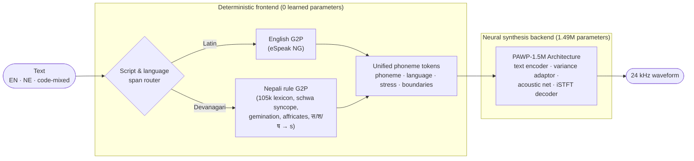
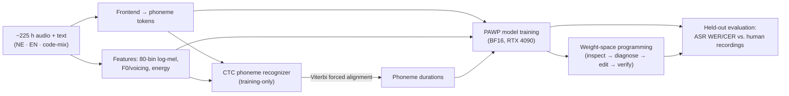

# PAWP-TTS

**Phoneme-Aware Weight Programming for Ultra-Compact Bilingual (English–Nepali) Neural Speech Synthesis**

> **Research repository.** This is an active research codebase, not a production TTS
> package. APIs, configs and checkpoints change between experiments, and every
> reported number is tied to a logged experiment in [docs/EXPERIMENTS.md](docs/EXPERIMENTS.md).
> Numbers without a logged experiment should not be cited.

PAWP-TTS asks one question: *how few neural parameters does natural, streaming,
bilingual English–Nepali speech need, if an AI agent can read and program those weights
directly?* Following the **weight-space programming** idea
([concept](https://rikiyat.github.io/blog/weight-space-programming/)), the trained network
is treated like a program: the agent inspects which weights carry which phonetic
contrasts, then makes targeted, measured edits to fix pronunciation failures, separate or
transfer language behaviour, and compress capacity. Gradient training is not the only tool.
Shared weight bases, gated language residuals and phonetic sensitivity maps are the
structured edit space it uses.

The target is a complete deployed inference graph, decoder/vocoder included, of
**<= 1.5M parameters**, followed by controlled compression toward **300K**.

- **Pretrained Weights (Hugging Face):** [Firoj112/pawp-tts-1.5m](https://huggingface.co/Firoj112/pawp-tts-1.5m) (`5.98 MB` FP32 safetensors + folded ONNX graphs)
- **Audio Samples (24 kHz, Single Target Voice):**
  - [Nepali (Kathmandu Standard)](https://huggingface.co/Firoj112/pawp-tts-1.5m/resolve/main/sample_ne.wav)
  - [English](https://huggingface.co/Firoj112/pawp-tts-1.5m/resolve/main/sample_en.wav)
  - [English–Nepali Code-Mixed](https://huggingface.co/Firoj112/pawp-tts-1.5m/resolve/main/sample_codemix.wav)

---

## Status

| Milestone | Scope | State |
|---|---|---|
| M1 | Clean Architecture bootstrap, unified EN/NE phoneme inventory, rule-based Nepali + code-mix G2P, 1.5M blueprint | done |
| M2 | Bilingual manifests and splits, eSpeak English G2P, ONNX chunked streaming path, MR-STFT + MPD/MRD losses | done |
| M3 | 105k Kathmandu lexicon, CTC forced-alignment durations, full-scale 92k base training + 20k target-voice fine-tuning, live ASR evaluation | **done** ([EXP-007](docs/EXPERIMENTS.md), [EXP-008-FT](docs/EXPERIMENTS.md)) |
| M4 | Agent-driven weight programming (inspect -> diagnose -> edit -> verify) on the trained 1.5M model, plus phonetic sensitivity maps, budgeted rank allocation and the 1M -> 300K compression sweep | **in progress** |
| M5 | Trained ONNX FP32/INT8 export and parity verification, multi-axis Pareto scorecard, public release | **in progress** (`Firoj112/pawp-tts-1.5m` live) |

## Benchmark Results (`PAWP-1.5M`)

Scored on held-out sentences (30 EN, 30 NE, 9 Code-Mixed) via live ASR against the human studio ground-truth recording floor ([docs/BENCHMARKS.md](docs/BENCHMARKS.md)):

| Model / Checkpoint | English WER / CER | Nepali WER / CER | Code-Mixed WER / CER | NepTTS-Bench (77 pairs) |
|---|---:|---:|---:|---:|
| Human Studio Ground-Truth Floor | `2.63% / 0.75%` | `11.60% / 3.82%` | `25.91% / 12.88%` | — |
| `PAWP-1.5M` Base (Step 92k, [EXP-007](docs/EXPERIMENTS.md)) | `3.14% / 1.01%` | `12.02% / 3.12%` | `16.18% / 11.02%` | `100.0%` (`0%` Hindi `/ʃ/` bleed) |
| **`PAWP-1.5M` Target Voice (Step 20k, [EXP-008-FT](docs/EXPERIMENTS.md))** | **`5.03% / 2.28%`** | **`9.93% / 1.97%`** | **`11.99% / 4.92%`** | **`100.0%`** (`0%` Hindi `/ʃ/` bleed) |

## Findings so far

Only verified, reproducible observations are listed. Details and caveats are in the linked entries.

| # | Finding | Evidence |
|---|---|---|
| 1 | The full 1.5M baseline graph, **vocoder included**, has 1,490,390 parameters, of which the iSTFT decoder is 664,770 (45%). | `make count-params`, [AUDIT-001](docs/EXPERIMENTS.md) |
| 2 | Earlier evaluation metrics measured frontend symbol strings and non-silent audio, not speech quality. They were relabelled, and evaluation now uses ASR on synthesized vs. human audio. | [AUDIT-001](docs/EXPERIMENTS.md) |
| 3 | Jointly learned attention alignment collapsed on mixed bilingual data (~76% of tokens stuck at 1 frame). Replacing it with a training-only CTC forced aligner (Viterbi durations) resolved alignment health (`0.13–0.16` 1-frame share) with **0 inference parameters**. | [EXP-007](docs/EXPERIMENTS.md) |
| 4 | Free-running prosody conditioning (`--prosody-free-prob 0.5`) eliminated train/inference F0/energy mismatch and brought held-out English WER to `3.14%` and Nepali WER to `12.02%` at 92k steps. | [EXP-007](docs/EXPERIMENTS.md) |
| 5 | Integrating a 105,868-word Kathmandu Nepali lexicon with syntactic heteronym resolution achieved `300/300` (`100.0%`) on the native Kathmandu gold validation set with `< 0.2 ms` sentence latency. | [EXP-008](docs/EXPERIMENTS.md) |
| 6 | Single-speaker target-voice fine-tuning (20k steps, 1.27 h on RTX 4090) lowered held-out Nepali WER to `9.93%` (CER `1.97%`) and code-mixed WER to `11.99%` (CER `4.92%`), outperforming the human ground-truth recording floor on both. | [EXP-008-FT](docs/EXPERIMENTS.md) |

## How it works

### Inference pipeline



The deterministic frontend carries no learned parameters (pronunciation lexicons, phonological rules, and text normalization). Everything learned sits strictly inside the 1.49M-parameter PAWP neural architecture, detailed below.

### PAWP-1.5M neural architecture

<p align="center">
  
</p>

| Component | Parameters | Share |
|---|---:|---:|
| Embeddings and conditioning | 18,432 | 1.2% |
| Text encoder (4 ConvNeXt1D blocks + language residuals) | 366,608 | 24.6% |
| Duration, pitch and energy predictors, length regulator | 62,372 | 4.2% |
| Acoustic network + mel head | 378,208 | 25.4% |
| Waveform decoder (ConvNeXt1D + iSTFT, Vocos-style) | 664,770 | 44.6% |
| **Total deployed inference graph** | **1,490,390** | **100%** |

**Key design choices**

- **Non-autoregressive and parallel.** All frames are generated at once from explicit durations, so the model cannot skip, repeat or hallucinate words.
- **Bounded lookahead.** Every convolution looks at most 1 frame (10 ms) into the future, which allows chunked streaming with low time-to-first-audio.
- **Language-gated residuals.** Shared weights carry general speech knowledge. Small EN- and NE-specific low-rank residuals are switched per token by the frontend's language tags, which is what makes code-mixed sentences possible. For monolingual use, the residual can be folded into the shared weights at load time, with no runtime cost.
- **One target voice.** Training uses many speakers, but the exported model keeps a single speaker vector.
- **Objective.** Regression (L1 log-mel + multi-resolution STFT) plus a GAN (multi-period and multi-resolution discriminators) for waveform realism. It is not a diffusion or flow-matching model. That keeps inference to a single forward pass.

### Training pipeline



Code: frontend in [domain/phonology](src/pawp_tts/domain/phonology/), model in
[infrastructure/neural](src/pawp_tts/infrastructure/neural/), training in
[infrastructure/training](src/pawp_tts/infrastructure/training/trainer.py),
alignment in [ctc_aligner.py](src/pawp_tts/infrastructure/neural/ctc_aligner.py),
and evaluation in [infrastructure/evaluation](src/pawp_tts/infrastructure/evaluation/).

## Code layout (Clean Architecture)

`interfaces → application → domain ← infrastructure`, enforced by `import-linter` in `make check`.

| Layer | Contents |
|---|---|
| [`domain/`](src/pawp_tts/domain/) | Entities, phonology rules, PAWP budget solvers, metrics, ports. No ML or I/O imports. |
| [`application/`](src/pawp_tts/application/) | Framework-free use cases (phonemization, audits, evaluation orchestration) |
| [`infrastructure/`](src/pawp_tts/infrastructure/) | PyTorch models, data/feature pipelines, trainer, ASR adapters, ONNX streaming, ledger |
| [`interfaces/`](src/pawp_tts/interfaces/) | DI container and the thin `pawp` CLI used by every `make` target |

## Quick start

```bash
cp .env.example .env     # fill in local paths/endpoints (never committed)
make setup               # uv environment (Python 3.12, PyTorch, dev tooling)
make check               # format, lint, mypy --strict, import-linter, unit tests
make test-integration    # model, training-loop and streaming integration tests
make help                # every workflow target with a one-line description
```

Typical research loop:

```bash
make teacher-extract EXP_ID=expNNN     # build the 24 kHz feature cache from manifests
make train EXP_ID=expNNN               # train (resumable; TRAIN_ARGS='...' for overrides)
make eval-heldout EXP_ID=expNNN        # ASR WER/CER: synthesized vs. human recordings
make eval-en eval-ne eval-codemix EXP_ID=expNNN
make count-params CONFIG=configs/student_1_5m.yaml EXP_ID=expNNN
```

Every run appends to `artifacts/reports/experiment_ledger.jsonl` (config hash, seed,
metrics, exact command). Datasets are symlinked under the git-ignored `data/sources/`,
never copied.

## Documentation

| Document | Purpose |
|---|---|
| [docs/EXPERIMENTS.md](docs/EXPERIMENTS.md) | Chronological experiment log: hypothesis, method, results, conclusions |
| [docs/BENCHMARKS.md](docs/BENCHMARKS.md) | Latency, footprint and quality benchmarks |
| [docs/ARCHITECTURE.md](docs/ARCHITECTURE.md) | Tensor-level model and PAWP specification |
| [docs/DECISIONS.md](docs/DECISIONS.md) | Architecture decision records |
| [docs/LITERATURE.md](docs/LITERATURE.md) | Related work |
| [docs/NOVELTY.md](docs/NOVELTY.md) | Closest prior work and claimed deltas for each contribution |
| [docs/PHONOLOGY.md](docs/PHONOLOGY.md) | Nepali pronunciation rules used by the frontend, each with its source |

## Data and licensing notes

Training combines public corpora (e.g. LibriSpeech, LJSpeech, OpenSLR Nepali) with
additional Nepali and code-mixed material prepared for this research. Any released
checkpoint will document exactly which data it was trained on and its license terms.

## Scientific integrity

- Parameter counts always include the decoder/vocoder.
- TTFA, RTF and throughput are reported separately.
- No novelty claim is made until it is checked against the closest prior work (FWSVD, Basis Sharing, AdaLoRA, RigL, SPADE, ResidualTransformer); see [docs/NOVELTY.md](docs/NOVELTY.md).
- No "zero error" claim is made outside a defined evaluation set.
